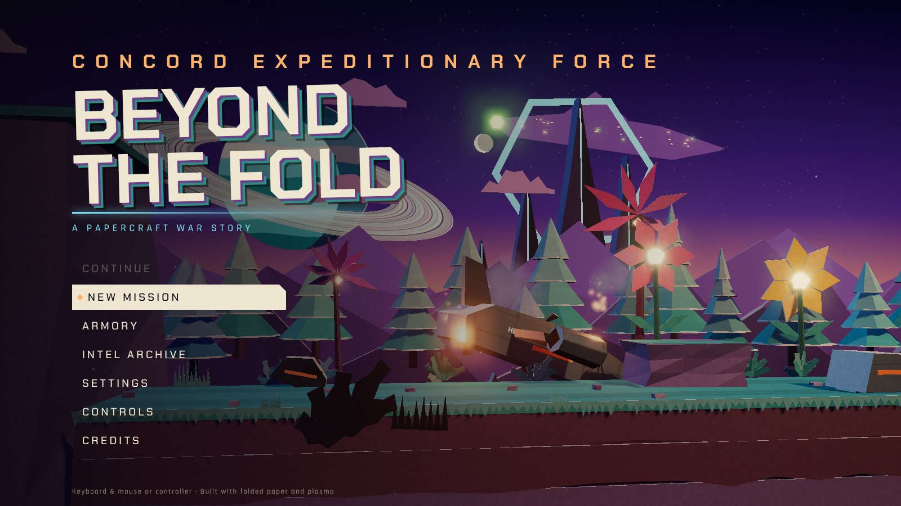
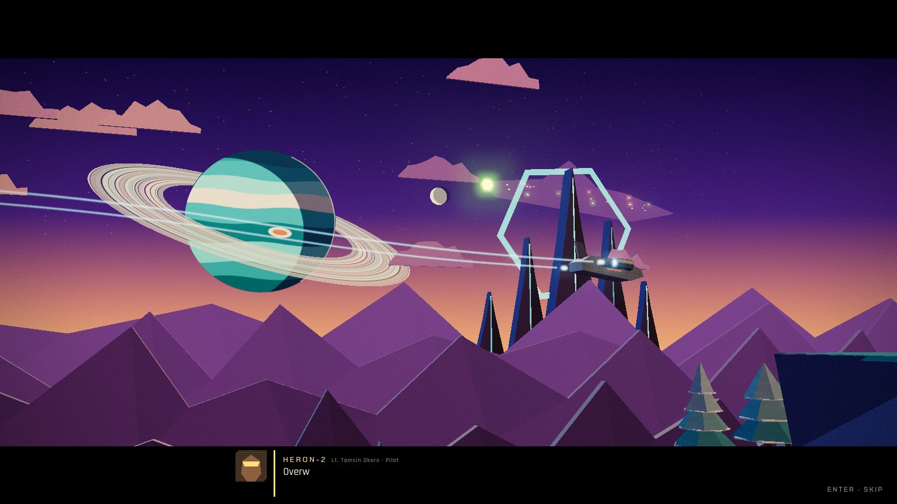
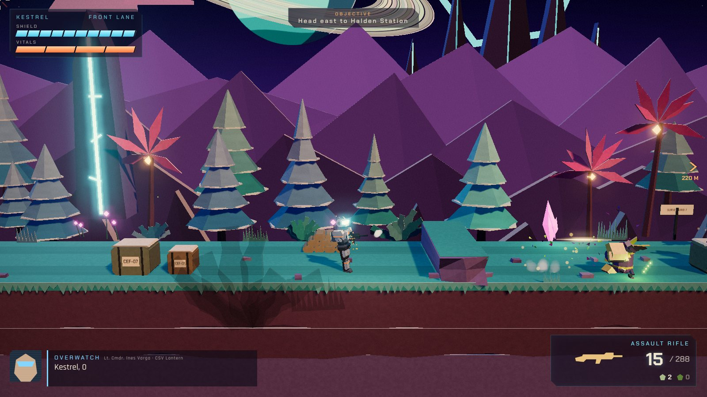
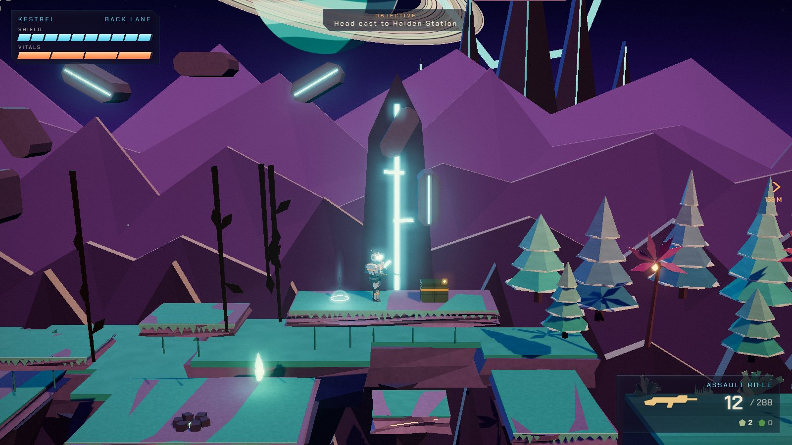
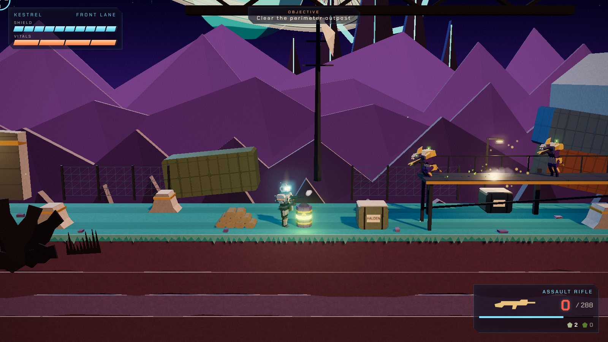
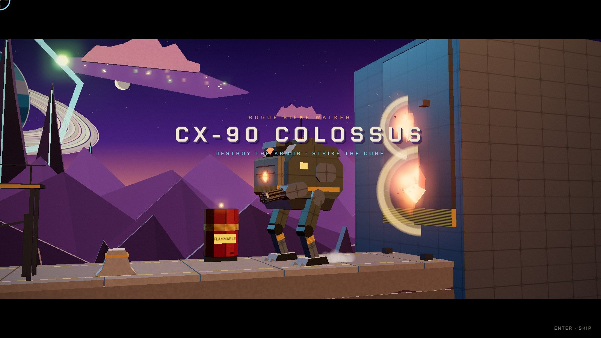
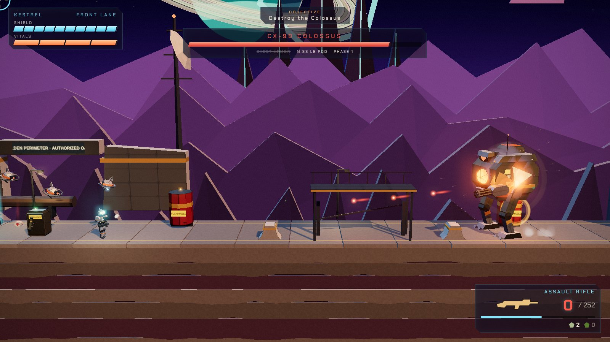

# Beyond the Fold

**A cinematic 2.5D science-fiction shooter set in a world built from folded paper.**

Military sci-fi combat — armored supersoldiers, alien infantry, plasma weapons, a rogue siege walker — staged inside a layered papercraft diorama: cardstock cliffs with cream cut edges, folded paper trees, faceted alien sculptures, foil-laminated machinery and explosions made of glowing folded shards.



| | |
|---|---|
|  |  |
|  |  |
|  |  |

## Story

Halden Deep Research Station on the outer-rim world **Teskaris** has been silent for forty hours. The Concord Expeditionary Force sends one Warden-Commando — callsign **KESTREL** — to find out why. The dropship is shot down on approach. Between Kestrel and the station: the **Thren**, an alien collective that has come to claim something buried beneath Halden, and the station's own security machines, whose friend-or-foe logic has been rewritten by a signal nobody can read.

The story unfolds through in-engine cinematics, squad radio (Overwatch on the orbiting CSV *Lantern*, the downed pilot Tam, and Kestrel's suit AI WREN), environmental storytelling and three recoverable intel logs.

## Play

You need a browser with WebGL2 (any current Chrome, Edge, Firefox or Safari). There is nothing to install.

- **Play online:** <https://claude.ai/artifact/XoAeCovVAN5jypKh4Lj7FV>. The link is private to its owner until it is shared from the page's Share menu.
- **Play offline:** download [`Beyond-the-Fold.html`](Beyond-the-Fold.html) (about 1 MB) and double-click it. The whole game is in that one file, including its code, styles and fonts, so it runs straight from disk with no server and no internet connection.

Click once inside the game window to enable sound. Controllers work in the downloaded file; some embedded web views block the Gamepad API.

## Building from source

Requirements: Node.js 18+.

```bash
npm install
npm run dev           # start the dev server, then open the printed URL
npm run build         # type-check and produce a static build in dist/
npm run preview       # serve the production build locally
npm run build:single  # rebuild the one-file Beyond-the-Fold.html
```

The build in `dist/` is fully static (relative asset paths), so it can be hosted on any static web host, including GitHub Pages.

## Controls

| Action | Keyboard & mouse | Controller |
|---|---|---|
| Move | A / D | Left stick |
| Aim | Mouse | Right stick (aim assist optional) |
| Fire (hold Ember Pistol to charge) | Left mouse | RT |
| Throw grenade | Right mouse / G | LT |
| Jump (hold for height) | Space | A |
| Crouch · Dodge roll (while moving) | C | B |
| Sprint | Shift | L3 |
| Step into background / foreground lane | W / S | D-pad or flick left stick up/down |
| Melee | F / V | RB |
| Reload | R | X |
| Interact / swap weapon | E | X (when a prompt is shown) |
| Switch weapon | Q / mouse wheel / 1–2 | Y |
| Cycle grenade type | T / X | LB |
| Pause | Esc / P | Start |

All keyboard bindings can be remapped in **Controls**. Cutscenes can be skipped with Enter/Space/Esc (A on a controller).

## The vertical slice: Mission 01 — *Landfall*

- **Cinematic introduction** — the Heron dropship crosses the Teskaris terminator, is hit by plasma flak and crashes; Kestrel wakes in the wreckage.
- **Crash site & ridge** — movement, aiming and lane-switching tutorials; first contact with Thren infantry while a corrupted Watchdog drone fires on everyone.
- **Shale chasm** — platforming over floating rock: crumbling platforms, timed plasma vents and a hidden upper path in the background lane with a supply cache and intel.
- **Perimeter outpost** — the major combat encounter: the arena locks behind energy barriers and three waves arrive (skirmishers and a shield-bearing Bulwark, then drones from the hangar, then Ravagers leaping in from the background while reinforcements drop).
- **Halden yard** — an ordnance locker, a rooftop cache and the final intel log.
- **Mini-boss: CX-90 Colossus** — a three-phase siege walker with destructible chest armor and missile pod, a precision sensor weak point, an exposed reactor core, telegraphed autocannon sweeps, missile barrages, stomp shockwaves and a sensor beam. Explosive fuel tanks in the arena stagger it and make the core vent.
- **Finale** — the structure beneath Halden opens; mission results, rank, challenges and unlocks.

Checkpoints are placed before the chasm, after it, and at the yard. Progress is saved automatically and can be resumed with **Continue**.

## Gameplay systems

**Movement** — responsive, weighty running with acceleration, coyote time, jump buffering and variable jump height; crouching, sprinting and invulnerable dodge rolls; two depth lanes you can step between to dodge, flank and find alternate routes.

**Combat**
- Projectile-based shooting with spread bloom, recoil climb, headshot bonuses and damage falloff.
- Rechargeable energy shields over segmented, partially regenerating health; shield breaks shatter visibly.
- Melee with lunge and back-stab takedowns; frag and sticky plasma grenades.
- Explosive canisters, destructible cover, crumbling platforms, plasma vents and pits.
- Two weapon slots with pickups, ammo drops and weapon swapping.

**Weapons** (data-driven in `src/data/weapons.ts`)

| Weapon | Class | Behaviour |
|---|---|---|
| AR-41 Vanguard | Assault rifle | Fully automatic, reliable all-rounder |
| BR-9 Longbow | Battle rifle | Three-round burst, high headshot multiplier |
| Thren Ember Pistol | Plasma pistol | Strips shields; hold to charge a homing overcharge that EMPs drones |
| SG-4 Breacher | Shotgun | 10-pellet spread with falloff, pump action, shell-by-shell reload |
| SR-2 Lancet | Sniper rifle | High-velocity slug, 3× headshots, widens the camera |
| RL-6 Hammerfall | Rocket launcher | Accelerating rocket, heavy damage to armor |
| Thren Prism Lance | Alien energy weapon | Shards that ricochet off hard surfaces |

**Enemies** — each with its own silhouette, behaviour and voice:

| Enemy | Role | Behaviour |
|---|---|---|
| Thren Skirmisher | Infantry | Keeps range, strafes, retreats to cover when its shield breaks, presses the attack while you reload, dodges grenades |
| Thren Bulwark | Shield unit | Directional hard-light barrier; turns slowly, so flank it, jump over it or overcharge it |
| Thren Ravager | Berserker | Stalks, roars, then charges in a straight line; slamming into a wall leaves it dazed |
| Watchdog Drone | Combat drone | Corrupted station security; hovers, strafes, jinks when hit, crashes and explodes |
| CX-90 Colossus | Mini-boss | Multi-phase walker described above |

Enemies perceive with line of sight, alert allies, follow you between lanes, and take turns attacking through a combat director's attack tokens. The Thren and the rogue machines are also hostile to each other.

**Progression** — mission ranks (S–D), five optional combat challenges, requisition points, six armory upgrades (shield recharge, shield capacity, ammo capacity, precision damage, grenade capacity, incendiary frags), a secondary-weapon loadout from unlocked weapons, armor and visor cosmetics, an intel archive, four difficulty levels (Recruit, Regular, Veteran, Ironclad) and replayable missions.

**Presentation**
- Real-time 3D with a perspective side-scrolling camera: smooth follow with aim look-ahead, arena framing, boss framing, trauma shake and cinematic overrides.
- Layered parallax: ringed gas giant, a Thren carrier in orbit, folded mountain ranges with atmospheric fog, the distant alien megastructure, foreground silhouettes that fade when they cover the player.
- Dynamic coloured lighting from muzzle flashes, plasma bolts, explosions, fires and hazards; soft shadows; bloom; a filmic grade with damage, low-health and shield-break effects.
- Procedural animation for every character: run/sprint/jump/land/crouch/roll, aiming, recoil, reloads, weapon switching, melee, grenade throws, hurt reactions, secondary motion on armor plates, Paper-Mario-style flip turns, and deaths that fold apart into paper pieces.
- Holographic HUD with shields, health, weapon, ammo, heat, grenades, objective marker, interaction prompts, boss bar, hit markers and damage direction.

**Audio** — everything is synthesised at runtime with the Web Audio API: layered weapon reports, explosions with debris, heavy armored footsteps, shield recharge and shatter, alien vocalisations with formant filters, ambient wildlife and wind, outpost machinery, and an adaptive score (string pads, choir, celesta, spiccato ostinato, war drums and brass) that intensifies for combat and the boss.

**Settings** — master/music/effects/radio volume, subtitles, quality preset, shadows, bloom, particle density, resolution scale, FPS counter, default difficulty, screen shake and controller aim assist. Settings and progress persist in local storage.

## Architecture

```
src/
  core/        loop-independent utilities: math, typed event bus, input (keyboard/mouse/gamepad, rebinding), settings, save data
  data/        data-driven content: weapons, grenades, enemies & difficulty, progression, story & radio, level layouts
  game/        the simulation (no rendering or audio)
    world.ts       entities, combat rules, explosions, triggers, encounters, checkpoints
    physics.ts     lane-aware AABB collision and raycasts
    player.ts      the Warden-Commando
    weaponState.ts shared weapon runtime driven by WeaponDef data
    enemy.ts       shared AI: perception, targeting, cover, attack tokens, movement helpers
    enemies/       Skirmisher, Ravager, Bulwark, Drone behaviour state machines
    boss/          the Colossus
    props.ts       barrels, cover, fuel tanks, hazards, checkpoints, pickups
  render/      Three.js presentation
    paper.ts       papercraft materials and geometry helpers
    models/        soldier, enemies, boss, weapons, props
    environment/   backdrop, terrain, decor, level scene
    views.ts       entity views reading simulation state
    fx.ts, particles.ts, lights.ts, batch.ts, camera.ts, renderer.ts
  audio/       synth engine, sound recipes, adaptive music, event-to-sound director
  ui/          HUD, radio subtitles, menus
  cinematics/  cutscene sequencer and scripts
  game.ts      application state machine and fixed-timestep loop
```

- The simulation runs at a fixed 60 Hz with interpolated rendering, so behaviour is identical at any frame rate.
- The simulation never imports rendering or audio code. It emits plain-data events (`shot`, `impact`, `explosion`, `enemyKilled`, …) that the renderer, audio director and HUD subscribe to.
- **Adding a weapon**: add a `WeaponDef` to `src/data/weapons.ts` (and optionally a model builder in `render/models/weapons.ts`).
- **Adding an enemy**: add an `EnemyDef` to `src/data/enemies.ts`, subclass `Enemy` with a `think()` state machine, register it in `World.spawnEnemy`, and add a model.
- **Adding a level**: create a `LevelData` file in `src/data/levels/` describing solids, props, decor, triggers, encounters, checkpoints and an optional boss.
- Static scenery is merged into a small number of vertex-coloured batches per spatial chunk, and character models are compacted per animated joint, keeping draw calls low.

## Credits

All characters, factions, locations, dialogue, models, environments, effects, music and sound are original and generated in code. Built with [Three.js](https://threejs.org/) (MIT) and [Vite](https://vitejs.dev/). Fonts: Chakra Petch and Rajdhani (SIL Open Font License) via Fontsource.
